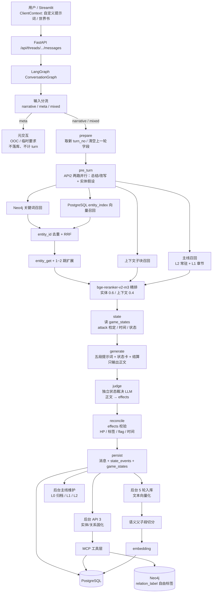
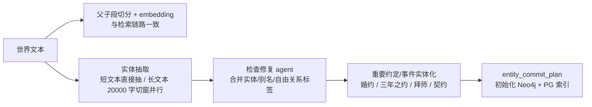
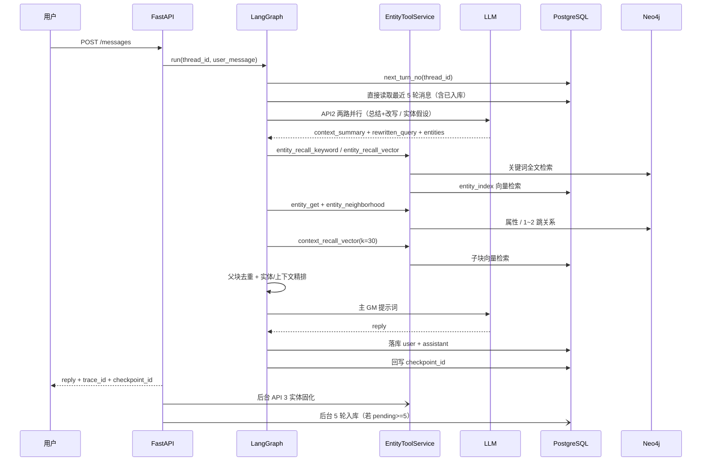
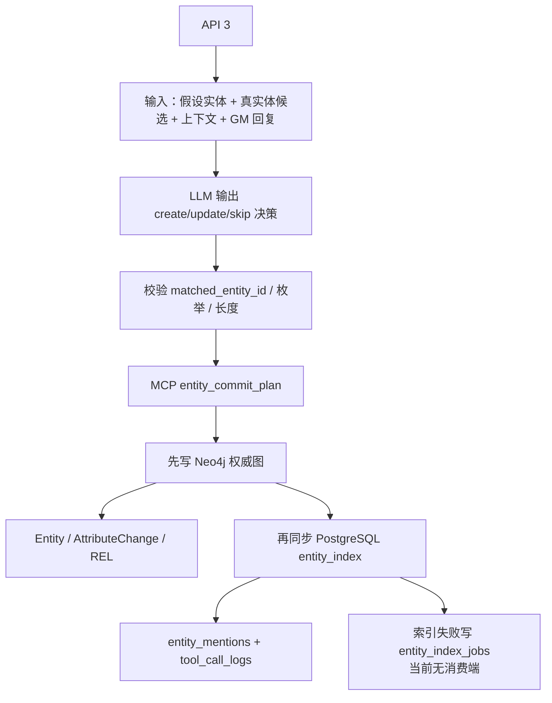
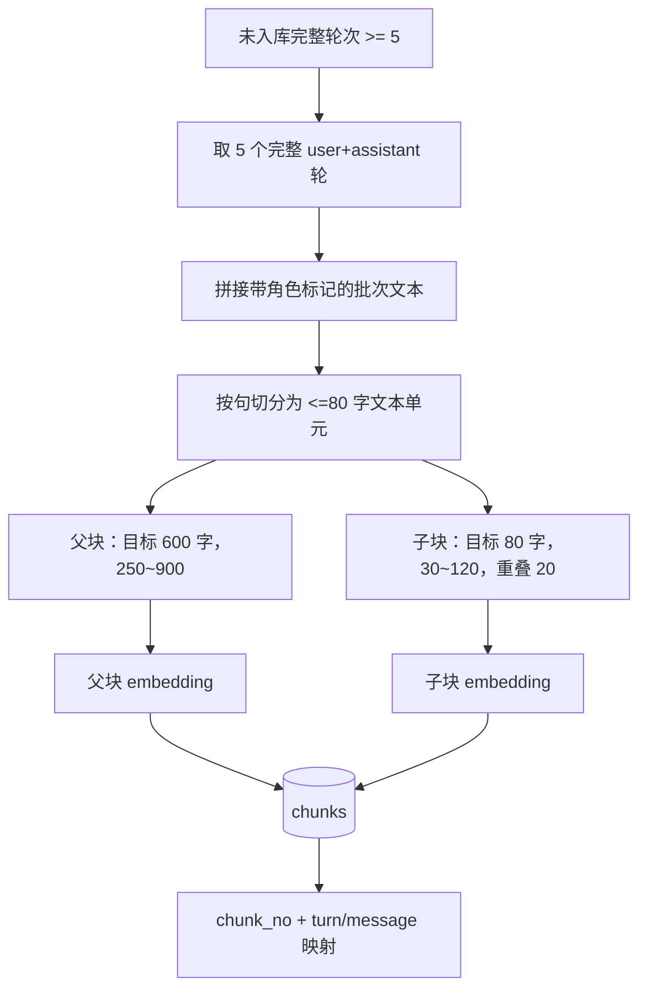

# 可迁移记忆内核：当前业务流程与信息处理说明

> 本文描述的是**可迁移记忆内核的参考实现**，不是最终规格。用于核对理解，发现偏差请直接指出。
> 内核不绑定具体作品；Streamlit、游戏 GM、数值/时间状态是参考前端与扩展层。验证结果见 `docs/eval_glm_2026-11-14.md`。

## 0. 可迁移边界

| 可替换层 | 内容 | 入口 |
|---|---|---|
| 世界观 | 小说/设定集/增量文本 | 世界导入 |
| GM | 角色、契约、OOC、输出格式 | `prompts/gm_*.md` |
| 实体/关系 | 类型、自由关系标签、事件实体化 | `domain/` + 导入/固化提示词 |
| 玩家自定义 | 自定义提示词、世界书、临时要求 | `ClientContext` |
| 工具/状态 | 检定、伤害、资源、时间/历法 | `numeric_engine.py` + 规则包 |

适用场景：长对话小说生成、文字互动游玩 / AI TRPG、个人陪伴助手、数字人。共同需求是实时更新、跨多轮一致、初期设定导入和后期自定义。

## 1. 系统全景



### 阶段 0：世界导入（一次性）



- 检索切片与实体抽取窗口**解耦**：抽取不复用父子段，避免同一实体反复抽取。
- 短文本（≤20000 字）一次抽取；长文本按 20000 字窗口切分，窗口抽取并行（默认 6 路，单次超时 240s），失败窗口再二分重试；单窗不调整理 agent。
- 所有抽取结果送 `world_consolidate.md` 检查修复 agent，由 LLM 合并重复实体、别名、繁简/异体写法和关系。
- 初始导入要求新线程；已有实体的线程拒绝导入，避免重复。
- 实体/关系经 `entity_commit_plan` 写入 Neo4j，并同步 PostgreSQL 实体向量索引。

存储职责：

- **PostgreSQL**：线程、消息、批次、文本父子段、实体派生向量索引、mention、召回轨迹、主线摘要、游戏状态/状态事件、工具调用日志、LangGraph checkpoint。
- **pgvector**：文本片段向量、实体名称向量。
- **Neo4j**：实体、属性变更、关系，是实体与关系的权威来源；关系使用自由 `relation_label`，重要约定/事件可实体化。
- **MCP 工具层**：API 2/3 与数据库之间的唯一入口；当前 API 2/3 进程内调用同一实现，MCP server 也可独立通过 streamable HTTP 暴露。

## 2. 一轮对话时序



## 3. 一轮对话的详细步骤

### 3.0 开场白

- 新线程（尚无 messages）首次进入前端时调用 `POST /api/threads/{id}/opening`。
- 有世界记忆时：召回世界观片段 → LLM 生成 150~300 字开场白。
- 无世界记忆时：使用通用开场白。
- 以 `assistant` 消息、`turn_no=0` 落库；`count_un_ingested_turns` 只统计完整 user+assistant 轮次，因此开场白不会提前触发 5 轮入库。
- 最近 5 轮原始上下文额外包含开场白，不占用 5 轮对话名额。

### 3.1 prepare

- 从 `messages` 表计算新的 `turn_no`。
- 清空上一轮 state 字段。
- 原因：LangGraph 会用 `thread_id` 恢复上一轮 checkpoint state，不能直接复用旧 `turn_no`。

### 3.2 pre_turn（API 2）

输入：`thread_id`、`user_message`、`turn_no`、最近 5 轮消息（含已入库）。

1. 编排层直接从 `messages` 读取最近 5 轮消息（含已入库），拼入提示词；**确定性读取不走 MCP**。
2. API 2 两路并行 LLM：
   - `api2_context.md`：先做输入分流，输出 `channel`（narrative/meta/mixed）和叙事 `intent`；再看上一轮输出 `context_summary` 和 `rewritten_query`。纯 meta 时输出 `directives` 或 `meta_question`。
   - `api2_entities.md`：看最近 5 轮，输出扁平 `entities` 检索词（实体名、别名、关键词，最多 12 个）。
   - **上下文检索用 `rewritten_query + context_summary`，实体检索用 `entities`**；单路失败时各自降级。
   - **纯 meta**：不召回、不生成故事、不落消息、不计 turn。前端保存为 `pending_instructions`，下次叙事请求静默生效；OOC 问题由 `gm_meta.md` 单独回答。
   - **mixed**：拆出 `narrative_query` 走故事流程，元要求作为本轮 `directives`。
3. 用 `entities` 做一次实体召回：
   - **关键词路**：Neo4j CJK 全文索引；失败降级 `CONTAINS`。
   - **向量路**：PostgreSQL `entity_index`，查询 bge-large-zh-v1.5 向量。
4. 实体候选按 `entity_id` 去重，保留两路名次/分数，RRF 融合。
5. 对融合后 top10 调用 `entity_get`，取最新属性和 1 跳关系。
6. 调用 `entity_neighborhood` 做 1~2 跳扩展：
   - 节点按 `entity_id` 去重；
   - 边按 `rel_id` 去重；
   - 跳过节点重复的环路；
   - 新邻居最多补 4 个，合并进实体候选。
7. 用增强后的 query 召回上下文子块 `k=30`，按 `parent_no` 父块去重：
   - 同一父块只保留最高分子块作为代表；
   - 其他 sibling 记入 `child_chunk_nos`；
   - 取 top10 父块。
8. 精排：
   - 实体 top10、上下文 top10 分别送 `bge-reranker-v2-m3`；
   - `local_score = 0.75 * rerank_score + 0.25 * route_norm`；
   - 实体权重 0.6，上下文权重 0.4。
9. 写 `retrieval_traces`：假设实体、关键词候选、向量候选、融合候选、上下文候选、精排分数、最终选择的父块/实体/多跳路径，以及 `query_analysis`。

### 3.3 generate（主 GM）

- 读取最近 5 轮原始消息作为完整上下文，无论是否已入库；召回结果过滤掉完全落在这 5 轮内的 chunk，避免重复。
- 当前这一轮用户输入在生成时还未落库，会单独追加在历史之后；所以实际是“最近 5 轮历史 + 当前输入”。
- 系统提示词五段拼装：
  - `gm_core.md`：GM 核心规则；
  - `gm_contracts.md`：按 `intent` 选择本轮响应契约（行动/调查/社交/战斗/日常/修炼/询问/默认）；
  - 玩家自定义提示词（前端随请求携带，不落库）；
  - 世界书命中条目（before/after 两段，前端携带，不落库）；
  - 记忆：主线、精排后的实体 top6、上下文父块 top4、多跳关系路径。
- 最后一条 user 消息追加本轮生成要求：契约、`directives`、`pending_instructions`、上一轮承接摘要；要求正文不得确认或复述这些要求。
- GM 只输出故事正文；调用 LLM 生成回复，不在本节点落库。

### 3.4 judge（状态裁决）

- GM 正文之后独立调用一次 LLM（`prompts/state_judge.md`）。
- 输入：玩家本轮输入、GM 正文、当前状态卡、本轮结算、最近对话。
- 输出：`{"effects": [...], "appearances": [...]}`，只提出正文中新产生且结算未覆盖的后果。
- `appearances` 是本轮登场的角色：reconcile 为其建立状态 actor，并按规范名/别名绑定到 Neo4j 实体；API 3 之后新建的角色在下一轮开始时补建状态。
- 失败或超时返回空 decisions，不影响正文与落库。

### 3.5 persist

- 写入 user + assistant 两条消息，同一 `turn_no`。
- 计算 `pending_turns = 未入库完整轮次数`。
- `ingest_required = pending_turns >= 5`。
- 图结束后取最终 checkpoint_id，回写这一轮消息的 `checkpoint_id`。

### 3.6 后台触发

不是图内 hook，而是 **PostgreSQL 任务表 + worker 轮询**：

```text
graph.run() 返回后，FastAPI 路由检查最终 state：
  commit_required  → background_tasks(kind=commit, dedupe=turn:N)   # API 3，每轮
  ingest_required  → background_tasks(kind=ingest, dedupe=turn:N)   # 5 轮入库
  每轮              → background_tasks(kind=plot,   dedupe=turn:N)   # 主线维护
```

- 入队在响应前完成，任务落 PostgreSQL；进程重启不丢。
- `services/task_worker.py` 在 FastAPI lifespan 启动，串行领取任务（`FOR UPDATE SKIP LOCKED`），执行成功置 `done`；失败按 `5s/10s/20s/40s` 退避重试，5 次后置 `failed` 并保留 `last_error`。
- 启动时把上次遗留的 `running` 任务重置为 `pending`，自然续跑。
- 世界导入/世界观入库也走同一队列（`world_import` / `worldview`）。
- `POST /api/threads/{id}/ingest` 可手动补偿入库。

## 4. API 3 实体/关系固化



规则：

- 已存在实体必须引用候选中的 `entity_id`。
- 新实体由 MCP 生成 `entity_id`。
- 属性 append-only，不覆盖旧值；关系允许多重边。
- 关系使用自由 `relation_label`（2~40 字），不做枚举限制；`rel_id` 包含标签，同一对实体的不同关系可并存。
- Neo4j 写成功即视为实体写入成功；PG 索引失败不阻塞，可重建。
- 每个实体 mention、属性变更、关系都带 `trace_id`、`batch_id`、`chunk_nos`、`message_ids`、`evidence`。

## 5. 5 轮增量入库



- 一个“轮次” = 一条用户消息 + 一条 GM 回复。
- **原始上下文窗口**：最近 5 轮原始消息始终保留在 LLM 上下文里，无论是否已入库；入库不会删除 messages。只有轮次被新消息挤出最近 5 轮后，才只通过召回提供。
- 父块用于展开上下文；子块用于向量召回。
- 对话 chunk 按轮次边界切分，`chunk_no` 形如 `B0002-T0003-P001-C002`；世界观 chunk 无 T 段。
- `chunks.turn_no` 与 `turn_start/turn_end` 同时落库，供召回与回退使用。
- 每个 chunk 保存 `char_start/char_end`、`turn_start/turn_end`、`message_ids`，用于召回留痕。
- 世界观文本通过 `scripts/seed_worldview.py` 以 `kind='worldview'` 批次进入同一线程，参与召回。

## 6. 存储与留痕

### PostgreSQL

| 表 | 作用 |
|---|---|
| `threads` | 线程 |
| `messages` | 消息、turn_no、checkpoint_id |
| `ingestion_batches` | 5 轮批次/世界观批次 |
| `chunks` | 文本父子段与向量 |
| `retrieval_traces` | 每次 API 2 的完整召回轨迹 |
| `plot_nodes` | 三层主线：L0 单轮摘要 / L1 章节摘要 / L2 全局梗概 |
| `game_states` | 数值/时间/装备/物品实例等游戏状态 |
| `state_events` | 每轮状态变化，供回退恢复 |
| `entity_index` | Neo4j 实体的派生名称向量索引 |
| `entity_mentions` | 实体 → 消息/片段/批次/trace |
| `entity_index_jobs` | PG 索引失败记录（只写不消费，重试 worker 未实现） |
| `tool_call_logs` | MCP 工具调用审计 |
| LangGraph checkpoint 表 | 每轮 state 快照，默认保留 5 轮 |

### Neo4j

- `:Entity`：`entity_id/thread_id/canonical_name/entity_type/aliases/summary/...`
- `:AttributeChange`：append-only 属性变更
- `:REL`：实体关系，允许多重边；`relation_label` 为自由短语，不做枚举
- 所有查询强制 `thread_id`。

### 关键标识

- `thread_id`：隔离单位
- `turn_no`：轮次
- `trace_id`：一次召回/固化链路
- `chunk_no`：批次内父子段编号
- `message_ids`：消息溯源
- `entity_id`：Neo4j 与 PG 共用
- `created_turn_no/created_batch_id/last_turn_no`：实体创建/最近更新轮次，用于回退
- `rel_id/change_id`：关系/属性变更溯源
- `checkpoint_id`：LangGraph 轮次锚点

## 7. MCP 与确定性读取

MCP server 只暴露需要模型决策后的写工具：

| 工具 | 作用 |
|---|---|
| `entity_commit_plan` | 唯一实体/关系写入工具（create/update/skip + 属性/关系） |

以下都是**确定性读取/召回**，由编排层直接调用 `EntityToolService` / `PostgresStore` 服务方法，不作为 MCP 工具：

- 最近 5 轮消息：直接 `store.get_recent_turns` 后拼 prompt
- `context_recall_vector`、`entity_recall_keyword`、`entity_recall_vector`
- `entity_get`、`entity_neighborhood`、`chunk_get`
- `retrieval_trace_write`（审计写入，由编排层直接调用）

MCP server 通过 `scripts/run_mcp_server.py` 独立暴露，默认 `127.0.0.1:8765/mcp`。

## 8. Checkpoint 策略

- `PostgresSaver`，与业务表共用 PostgreSQL。
- `thread_id` 作为 checkpoint 线程键。
- 每轮节点都会产生 checkpoint；图结束后取最终 `checkpoint_id` 回写 `messages.checkpoint_id`。
- 默认保留最近 5 轮（`CHECKPOINT_RETENTION_TURNS=5`）：
  - 按 checkpoint 的 `channel_values.turn_no` 保留；
  - 删除旧 checkpoints/writes/未被引用 blobs；
  - 旧消息 `checkpoint_id` 置空；
  - 保留 checkpoint 的 parent 若指向被删 checkpoint，置空避免悬挂。
- `get_state_history` 可查看保留窗口内的节点级快照。

## 9. 当前已完成 vs 未完成

**已闭环：**

- 世界导入 + 增量导入：上下文向量化、实体/关系初始化、检查修复 agent
- 新线程开场白（turn_no=0，不计入 5 轮批次）
- Streamlit 会话列表 + 最近 5 轮回退/重试
- LangGraph 编排、5 轮增量入库、父子段切分/编号/溯源
- 实体关键词 + 向量双路召回、1~2 跳扩展、父块去重、bge-reranker 精排
- API 2 两路并行（单轮总结+改写 / 实体假设）
- 三层主线摘要（L0 单轮 / L1 章节 / L2 全局）
- API 3 实体/属性/关系固化，MCP `entity_commit_plan`
- 独立状态裁决（`state_judge`）：正文 → effects/appearances，登场角色绑定实体
- 后台任务 PG 队列 + worker：崩溃恢复、失败退避重试、世界导入复用同一队列
- 重复实体手动合并脚本（`scripts/merge_duplicate_entities.py`）
- 三套世界观的迁移测试（玄幻 / 现实 / 西幻）
- checkpoint 保留 5 轮
- 94 个测试

**当前边界：**

- 后台任务是单 worker 串行；多实例部署时需要按 `thread_id` 加锁或分片，长任务会阻塞后续任务
- 无多租户/JWT
- 没有正式评测集（Recall/MRR/主线忠实度）
- 重复实体合并是手动脚本，未做定时任务；别名近义（如「萧熏儿」「萧薰儿」）依赖 API3 写入 aliases
- 精排仍在 CPU
- 状态管道（情绪/场景滚动状态）未实现
