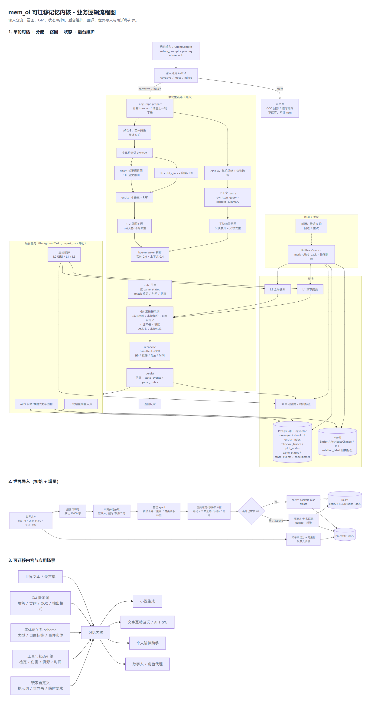
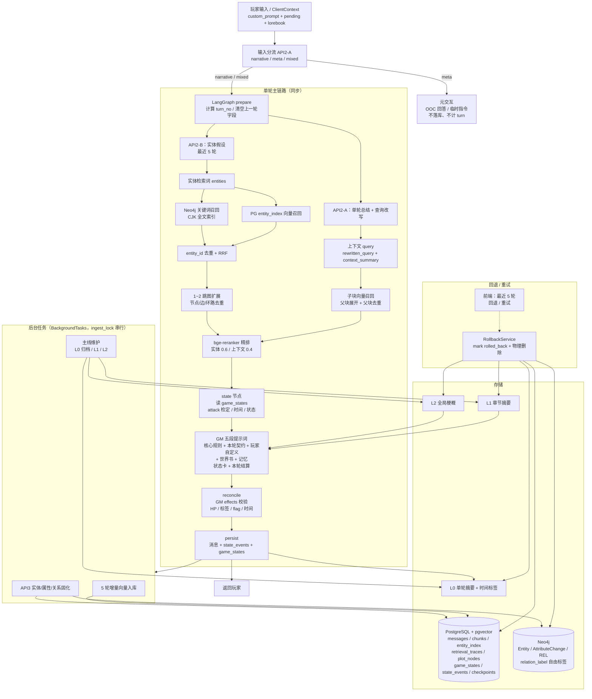
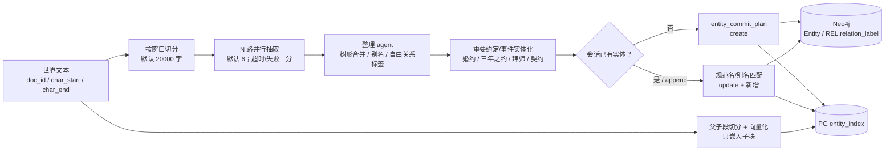
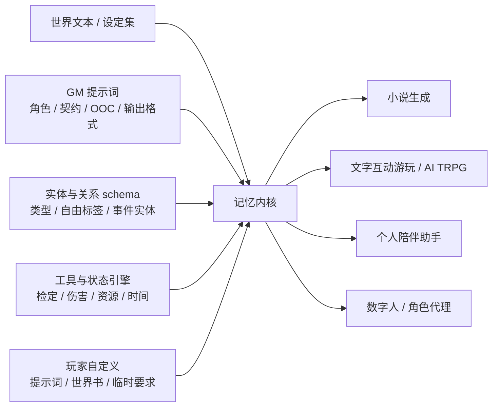

# 可迁移记忆内核：业务逻辑流程图

> 当前实现的输入分流、召回、GM、状态/时间、后台维护、回退和世界导入。
> 参数与边界见 `docs/current_state.md`；验证结果见 `docs/eval_glm_2026-11-14.md`。

> 图片来源：`business_logic_flow.html`（Mermaid 渲染）。

## 1. 单轮对话 + 分流 + 召回 + 状态 + 后台维护

## 2. 世界导入（初始 + 增量）

## 3. 可迁移内容与应用场景

共同需求：**实时更新、长对话一致性、初期设定导入、后期自定义**。玩法与表现层可替换，记忆内核不变。

## 4. 关键规则

- **输入分流**：`narrative / meta / mixed`；纯 meta 不落消息、不计 turn；mixed 只把叙事部分送入 GM。
- **API2**：单轮总结 + 查询改写与实体假设两路并行。
- **三条召回**：实体路（关键词 + 向量 + 图扩展）、上下文路（子块 → 父块）、主线路（L2 常驻 + L1 章节）；自定义世界书和提示词由前端随请求携带，不落库。
- **GM**：五段提示词 + 隐藏 `plan`；只返回 `reply`。
- **状态与时间**：GM 根据剧情输出 `hp_delta/tag/flag/scale/time_advance`，引擎校验后写 `game_states`；时间按规则包历法推进，和 HP 一样由工具层修改。
- **关系**：`relation_label` 是自由短语，不做枚举；同一对实体的不同标签是不同边；重要约定/事件做成 event 实体。
- **主线生命周期**：L0 每轮一次，5 轮内 active，离开窗口后归档并向量化；L1 每 5 条 L0 合并；L2 每个新章节递归合并。
- **回退**：消息标记 `rolled_back`，物理删除 chunks/entity_index/mentions/traces/plot_nodes/state_events 和 Neo4j 对应实体/关系；checkpoint 只用于对话状态。
- **后台任务**：API3、5 轮入库、主线维护都走 `BackgroundTasks`，当前不可持久化。
