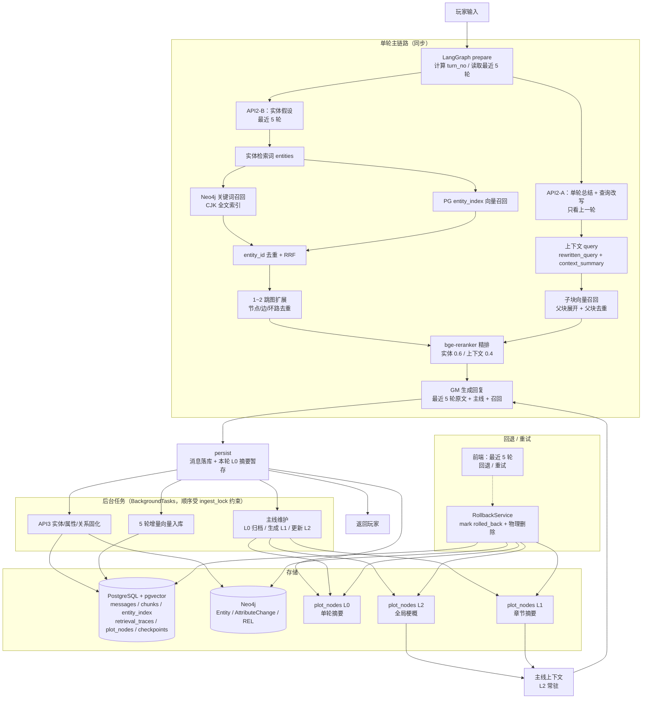
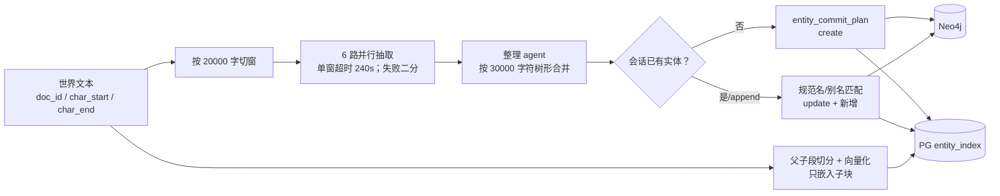

# 业务逻辑流程图

> 当前实现的单轮对话、召回、后台维护、回退和世界导入。参数与边界见 `docs/current_state.md`。

> 图片来源：`business_logic_flow.html`（Mermaid 渲染）。

## 1. 单轮对话 + 召回 + 后台维护

## 2. 世界导入（初始 + 增量）

## 3. 关键规则

- **API2 两路并行**：A 路只看上一轮，产出 `context_summary + rewritten_query`；B 路看最近 5 轮，产出扁平 `entities`。
- **三条召回**：实体路（关键词 + 向量 + 图扩展）、上下文路（子块 → 父块）、主线路（L2 常驻 + L1 章节）。
- **主线生命周期**：L0 每轮一次，5 轮内 active，离开窗口后归档并向量化；L1 每 5 条 L0 合并；L2 每个新章节递归合并。
- **回退**：消息标记 `rolled_back`，物理删除 chunks/entity_index/mentions/traces/plot_nodes 和 Neo4j 对应实体/关系；checkpoint 只用于对话状态。
- **后台任务**：API3、5 轮入库、主线维护都走 `BackgroundTasks`，当前不可持久化。
